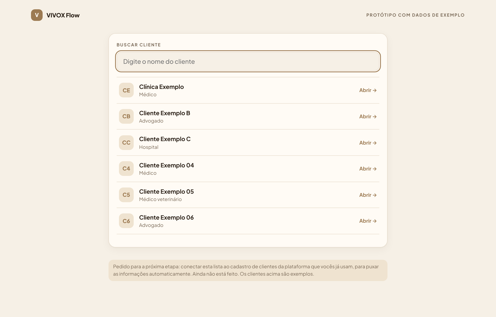
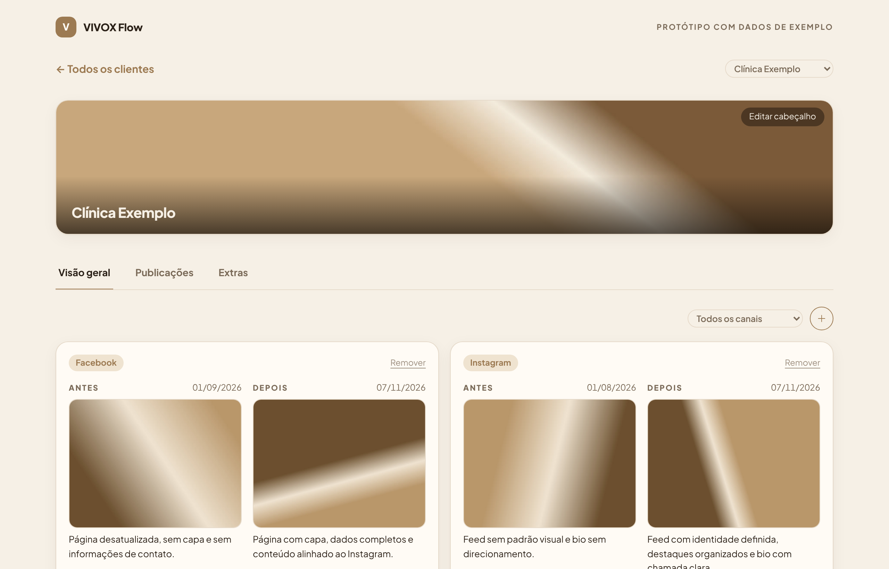
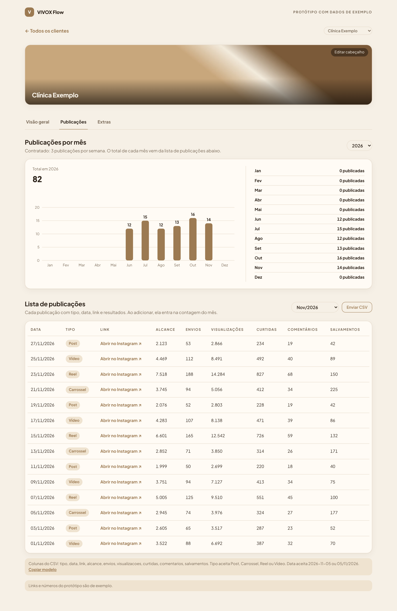
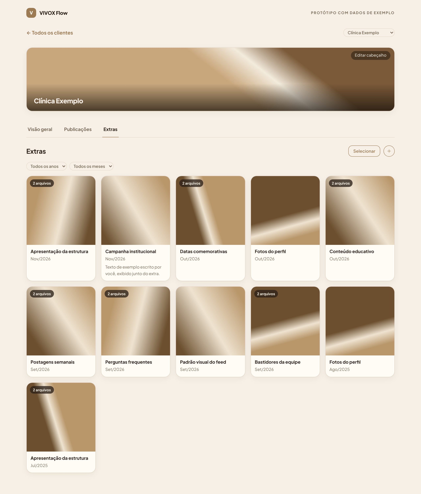
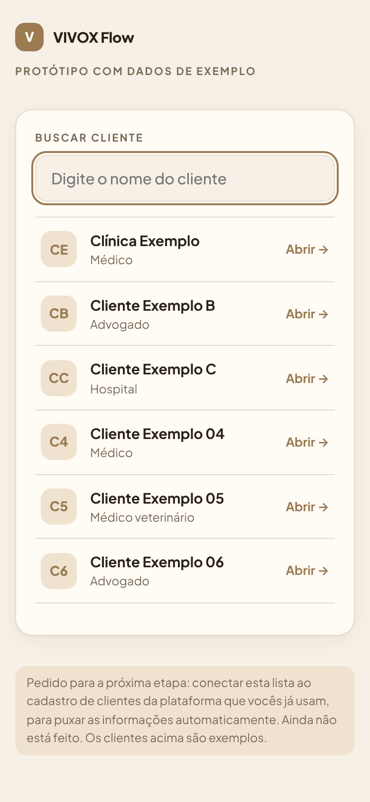
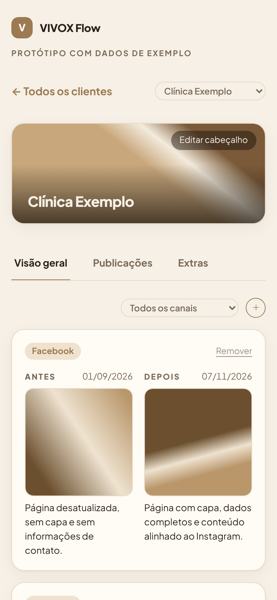
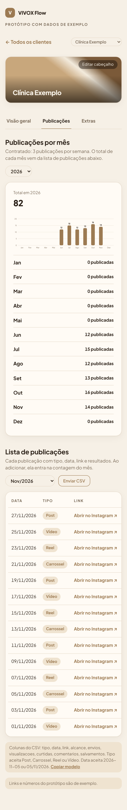
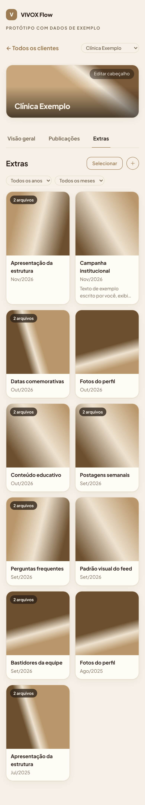

# VIVOX Flow: página Acompanhamento (protótipo)

Página única (`index.html`) para ver, por cliente, o antes e depois, as publicações do Instagram e os extras (pastas de fotos e vídeos). Funciona no celular e no computador. Visual creme e bronze, com a tipografia do VIVOX Flow.

> Dados e fotos são de exemplo. O que você adiciona fica só na memória do navegador e some ao recarregar.

## Como abrir

Abra o `index.html` no navegador. Para ir direto a um cliente: `index.html#clinica-exemplo`.

## Capturas

| Lista de clientes | Visão geral |
|---|---|
|  |  |

| Publicações | Extras |
|---|---|
|  |  |

| Lista | Visão geral | Publicações | Extras |
|---|---|---|---|
|  |  |  |  |

## O que tem

- **Lista de clientes:** busca pelo nome e a categoria de cada um (Médico, Médico veterinário, Advogado ou Hospital).
- **Cabeçalho do cliente:** foto e nome, com "Editar cabeçalho".
- **Visão geral:** antes e depois lado a lado. Canal, data da contratação e as duas fotos são obrigatórios.
- **Publicações:** gráfico por mês (com menu de ano) e lista do Instagram. O total do mês é contado pela lista. As publicações entram por CSV.
- **Extras:** pastas de fotos e vídeos, em ordem de contratação, com capa, descrição opcional e limite de 500 MB por arquivo.

### CSV de publicações

```
tipo,data,link,alcance,envios,visualizacoes,curtidas,comentarios,salvamentos
Reel,05/11/2026,https://www.instagram.com/reel/EXEMPLO/,5000,80,9000,600,40,90
```

Tipo: Post, Carrossel, Reel ou Vídeo. Data: `05/11/2026` ou `2026-11-05`. Vírgula ou ponto e vírgula.

## Dados e id

Os dados de exemplo estão na lista `CLIENTS`, no começo do script do `index.html`.

| Campo | O que é |
|---|---|
| `id` | Identificador do cliente. Vira o endereço `index.html#id`. |
| `nome` | Nome da empresa. |
| `seg` | Categoria do cliente. |
| `ini` | Iniciais do avatar. |
| `metricas` | Diferente de `null` libera as abas. Com `null`, mostra "ainda não tem dados". |
| `pub` | `{ pacote, semanal, meses }`: texto do pacote, publicações por semana e meta por mês. |
| `posts` | `[tipo, 'AAAA-MM-DD', link, alcance, envios, visualizacoes, curtidas, comentarios, salvamentos]` |
| `ba` | Antes e depois: `{ canal, antes:{u}, depois:{u}, legAntes, legDepois, dataContrato, dataAtual }` |
| `port` | Extras: `{ titulo, anoIni, mesIni, anoFim, mesFim, fotos:[{u,v}], capa, capaFora, desc, showDesc }` |
| `hdrFoto`, `hdrHist` | Foto de cabeçalho `{u,x,y,z}` e as anteriores. |
| `canaisBA` | Canais do antes e depois. |

**Mudar o id:** troque o valor de `id` em `CLIENTS`. Use minúsculas, sem acento e com hífen (`clinica-nova-vida`). Cada id é único. Links com o id antigo deixam de funcionar. Na integração, use o id do cadastro de clientes.

**Adicionar cliente:** inclua um objeto em `CLIENTS` com `id`, `nome`, `seg`, `ini` e `metricas` diferente de `null`.

O script usa ids fixos de elementos (`#busca`, `#addbtn`, `#csvbtn` e outros). Ao renomear, atualize o script.

## Anotações para a TI (Kelson)

### Pedido: ligar com a página do cliente (não feito)

O sistema já tem a página do cliente, com dados e fotos cadastrados. O protótipo muda só o layout. Por isso:

1. **Manter tudo salvo.** O que já foi adicionado no sistema continua salvo, sem perder nada. O que for adicionado nesta página (antes e depois, publicações, extras, capas, ordem e cabeçalho) também precisa ser salvo e voltar nas próximas aberturas.
2. **Puxar da página do cliente, sem cadastrar duas vezes.** Os campos do protótipo que podem vir de lá:
   - `id`: usar o identificador do cadastro.
   - `nome`: nome da empresa.
   - `seg`: categoria (Médico, Médico veterinário, Advogado ou Hospital).
   - Foto de perfil: hoje o avatar mostra só as iniciais (`ini`). Usar a foto de perfil já cadastrada.
   - Foto de cabeçalho (`hdrFoto`): a opção "Usar a foto que já existe no sistema" está desativada, esperando isso.
   - Se necessário: canais contratados (`canais`), pacote e publicações por semana (`pub.pacote` e `pub.semanal`) e data da contratação.
3. Só o que não existe no cadastro é adicionado aqui. O que já existe lá aparece automático.

### Pedido: aceitar PDF e PPT nos Extras (não feito)

Hoje o extra aceita só fotos e vídeos. Precisa aceitar também PDF e apresentações (PPT e PPTX) na mesma pasta.

1. **Formatos:** liberar nos campos de envio (`#a_f` no formulário do extra, `#lbfile` no extra aberto) e no filtro do arrastar e soltar. Tipos: `.pdf` (`application/pdf`), `.ppt` (`application/vnd.ms-powerpoint`), `.pptx` (`application/vnd.openxmlformats-officedocument.presentationml.presentation`).
2. **Tipo do arquivo:** hoje cada arquivo é `{ u, v }` (endereço e se é vídeo). Falta um campo de tipo, por exemplo `t: 'foto' | 'video' | 'pdf' | 'ppt'`.
3. **Exibição:** PPT não aparece no navegador, então a miniatura pode ser um ícone com nome e extensão. O PDF pode abrir em outra aba.
4. **Capa:** documento não pode ser capa.
5. **Mantém igual:** limite de 500 MB, ordem por arrastar e remoção com confirmação.

Funções envolvidas: `isVid`, `limite`, `mediaThumb`, `lightbox` e `openAdd`. Há um comentário "PEDIDO PARA A TI" no `index.html`, perto de `isVid`.

### Outras anotações

- **Envio de arquivos:** hoje os arquivos são lidos no navegador. No sistema real, enviar e guardar no servidor, com limite de 500 MB por arquivo.

## Limitações

- Envio de arquivos no iPhone não confirmado em aparelho.
- Alguns vídeos (.mov e .avi) podem não tocar. A página avisa e pede MP4.
- Arquivos muito grandes podem deixar o celular lento.

## Arquivos

```
index.html   a página inteira
RAVOX.md     este arquivo
docs/        capturas de tela
```
