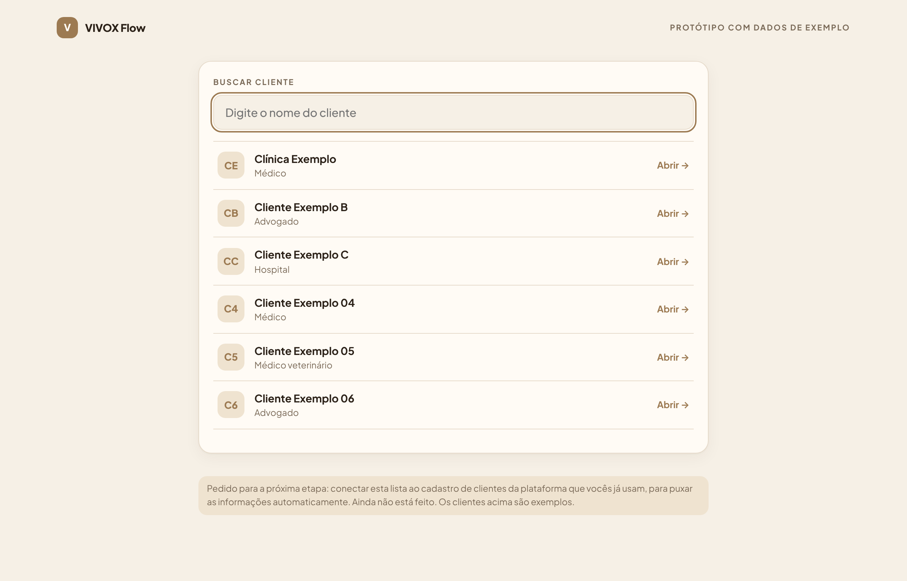
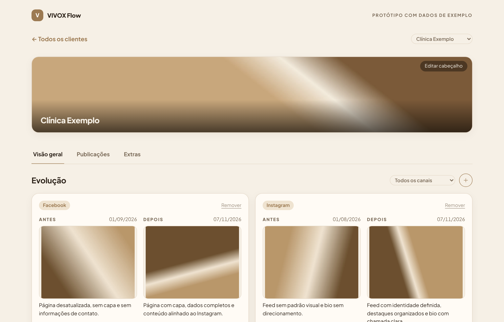
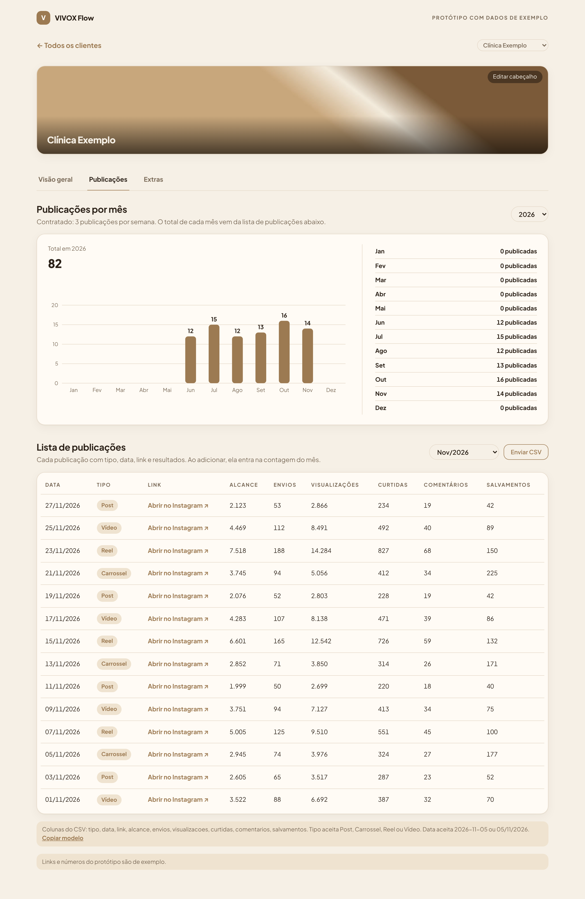
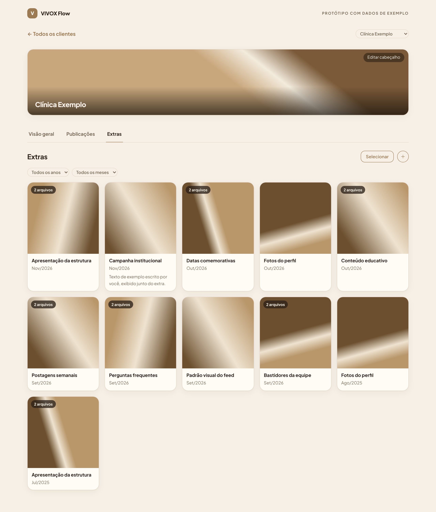
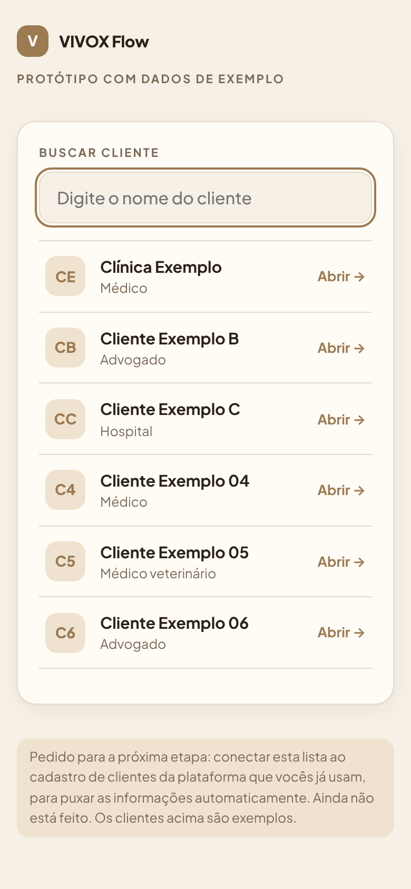
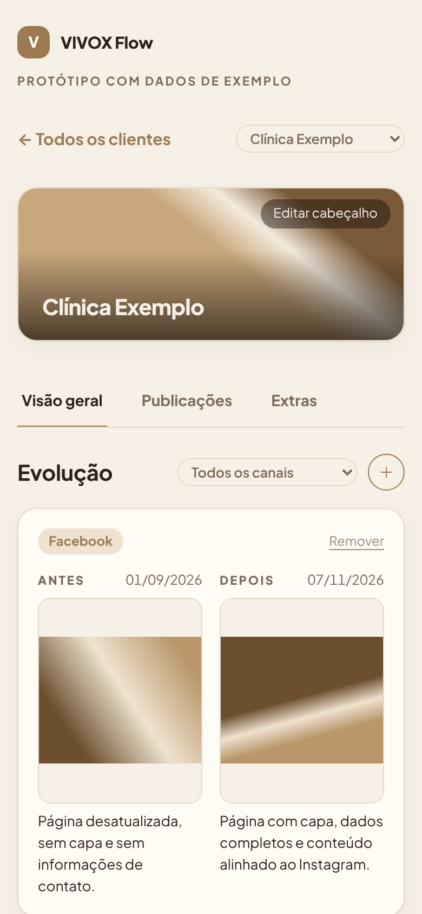
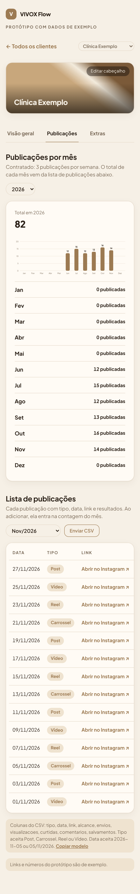
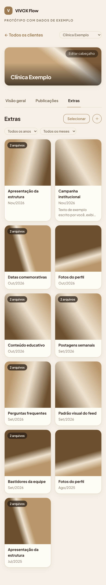

# VIVOX Flow: página Acompanhamento (protótipo)

Protótipo navegável da página **Acompanhamento** do VIVOX Flow. A ideia é reunir, em um lugar só, tudo o que foi feito para um cliente: a evolução (antes e depois), as publicações do Instagram e os extras (pastas de fotos e vídeos).

É um único arquivo, `index.html`, sem instalação. A mesma página funciona no celular e no computador: no celular as seções ficam empilhadas, no computador elas se espalham em mais colunas.

> Os dados e as fotos são de exemplo. Tudo o que você adiciona na página fica só na memória do navegador e some ao recarregar. Veja a seção "Anotações para a TI".

## Como abrir

1. Baixe o repositório ou só o arquivo `index.html`.
2. Abra o arquivo em qualquer navegador.
3. Para abrir direto em um cliente, use o endereço com o id dele, por exemplo `index.html#clinica-exemplo`.

A fonte (Plus Jakarta Sans) vem do Google Fonts. Sem internet, a página usa uma fonte do sistema, que fica parecida mas não igual.

## Capturas

Desktop (tela de 1280 px):

| Lista de clientes | Visão geral |
|---|---|
|  |  |

| Publicações | Extras |
|---|---|
|  |  |

Celular (390 px de largura):

| Lista | Visão geral | Publicações | Extras |
|---|---|---|---|
|  |  |  |  |

As fotos das capturas são imagens de exemplo geradas só para teste.

## Identidade visual

- Só creme e bronze, mais a tipografia do VIVOX Flow (geométrica, sem serifa). Sem as cores das colunas do quadro.
- Visual limpo e delicado: filtros pequenos e simples, botões discretos, poucos textos.
- Tem versão escura, que segue o tema do aparelho.

## Como a página funciona

**Tela inicial.** Um campo de busca e a lista de clientes (pensada para uns 20). Cada linha mostra só a categoria do cadastro: Médico, Médico veterinário, Advogado ou Hospital. Enter abre o primeiro resultado.

**Página do cliente.** No topo, o cabeçalho e, abaixo, três abas.

- **Cabeçalho.** Foto de cabeçalho com o nome da empresa sobre ela. O texto pequeno "Editar cabeçalho" abre um formulário com o nome da empresa e a foto. A foto pode ser ajustada arrastando e com um controle de zoom lento e suave. Há uma área "Anteriores" para voltar a fotos já usadas (as 12 mais recentes). Sem foto, o topo mostra só o avatar com as iniciais e o nome.
- **Visão geral (Evolução).** Antes e depois lado a lado, um cartão por caso. Detalhes abaixo.
- **Publicações.** Gráfico de publicações por mês e lista de publicações do Instagram. Detalhes abaixo.
- **Extras.** Pastas de arquivos (fotos e vídeos) sobre um assunto. Detalhes abaixo.

### Evolução

- Botão "+" (círculo pequeno) abre o formulário de nova evolução.
- Campos obrigatórios: **canal**, **data da contratação**, **foto do antes** e **foto do depois**. Se faltar algo, o formulário não salva, avisa o que falta e destaca o campo.
- Canais: Google Meu Negócio, Instagram e Facebook. A opção "+ Criar novo canal" continua disponível.
- Data da contratação: campo para digitar (dd/mm/aaaa, as barras entram sozinhas) com três menus ao lado (Dia, Mês e Ano), que andam juntos com o campo.
- A data do **Depois** é sempre a de hoje, preenchida sozinha no dia em que o registro é salvo.
- Legenda opcional em cada lado (por exemplo, "como estava").
- Clicar em uma foto abre em tela cheia, com uma seta transparente ao lado para alternar entre Antes e Depois. Sair: clicar na área escura, no × ou Esc. As setas do teclado também funcionam.
- Filtro "Todos os canais" e ordem pela data de contratação, do mais recente para o mais antigo.
- "Remover" em cada cartão pede confirmação.

### Publicações

- Texto de cima: `Contratado: 3 publicações por semana` (vem do campo `pub.pacote`).
- O **total de cada mês é contado automaticamente** pelas publicações da lista, no mês da data de cada uma. Não existe lançamento manual de extras.
- Gráfico com uma barra por mês e o total do ano. Menu de **ano** (por exemplo 2025 ou 2026), que abre no ano mais recente.
- **Lista de publicações** com: data, tipo (Post, Carrossel, Reel ou Vídeo), link do Instagram, alcance, envios, visualizações, curtidas, comentários e salvamentos. Filtro por mês, abrindo no mês mais recente.
- **Enviar CSV** adiciona publicações à lista e atualiza o gráfico. Links repetidos são ignorados e a página informa quantas linhas entraram, quantas já existiam e quantas foram ignoradas.

Formato do CSV (a primeira linha é o cabeçalho; vírgula ou ponto e vírgula):

```
tipo,data,link,alcance,envios,visualizacoes,curtidas,comentarios,salvamentos
Reel,05/11/2026,https://www.instagram.com/reel/EXEMPLO/,5000,80,9000,600,40,90
```

O botão "Copiar modelo" copia esse exemplo. A data aceita `2026-11-05` ou `05/11/2026`. O tipo aceita Post, Carrossel, Reel ou Vídeo.

### Extras

- Cada extra é uma **pasta de arquivos sobre um assunto**, com fotos e vídeos misturados. Não há tipo de material.
- Campos: título, descrição (opcional), **data da contratação (mês e ano)**, fotos e vídeos, capa à parte (opcional).
- Ordem pela contratação, do mais recente para o mais antigo. Entre extras do mesmo mês, o último adicionado aparece primeiro. Filtros de **ano** e **mês**.
- **Descrição** com a opção "Mostrar a descrição". Desmarcada, o texto fica guardado mas não aparece em lugar nenhum, e não há etiqueta de "oculta".
- **Capa:** pode ser um arquivo da galeria ("Usar como capa") ou uma imagem enviada à parte ("Enviar capa"). Um vídeo também pode ser capa.
- **Ordem dos arquivos:** arraste as miniaturas de um lado para o outro, ou use "← Mover" e "Mover →" (útil no celular).
- **Vídeo:** toca no próprio extra, com botão de tela cheia. Recomenda-se MP4 (H.264).
- **Remover uma foto ou vídeo:** texto pequeno e discreto, com confirmação.
- **Selecionar:** o botão "Selecionar" mostra uma bolinha em cada quadro. Com um quadro marcado, "Editar" abre o formulário já preenchido. Com um ou mais marcados, "Apagar" remove os quadros inteiros, sempre com a confirmação "Tem certeza que quer remover?".
- **Limite de 500 MB por arquivo.** Arquivos maiores não são adicionados e a página avisa qual foi.
- É possível arrastar fotos e vídeos direto para dentro do extra aberto.
- Clicar fora da janela fecha. Esc também.

## Regras que a Ana definiu (resumo das instruções)

- Não usar as cores das colunas do quadro nem criar kanban. Só creme, bronze e a tipografia do sistema.
- Tudo o que se refere a um cliente fica em um só lugar, sem precisar clicar demais para ver as fotos.
- Filtros simples e delicados, pequenos e sem excesso de botões.
- Lista de clientes com busca, sem tags de canal. Mostrar só a categoria cadastrada.
- Sem frases explicativas acima dos títulos, sem "Atualizado em", sem etiquetas desnecessárias.
- Métricas por canal (seguidores, alcance e similares) foram retiradas. Ficam só as publicações do Instagram.
- Publicações por mês: sem "pacote por mês" nem conceito de "extras" no gráfico. O texto diz "Contratado".
- Antes e depois: só a foto, as duas datas e a legenda. Canal, data e as duas fotos são obrigatórios.
- Extras: sem tipo de material. Cada um é uma pasta de arquivos.
- Remoção sempre com confirmação. Remover uma foto é um texto discreto, e apagar quadros inteiros é feito pelo modo "Selecionar".
- Botões de adicionar são só um "+", de tamanho médio e delicado.

## Dados e identificadores (id)

Os dados de exemplo ficam no começo do script, na lista `CLIENTS` dentro de `index.html`. Cada cliente é um objeto:

| Campo | O que é |
|---|---|
| `id` | Identificador do cliente. Vira o endereço `index.html#id`. |
| `nome` | Nome da empresa, mostrado na lista e no cabeçalho. |
| `seg` | Categoria: `Médico`, `Médico veterinário`, `Advogado` ou `Hospital`. |
| `ini` | Iniciais do avatar. Se o nome for editado na página, é recalculado. |
| `canais` | Canais contratados (hoje só informativo). |
| `metricas` | Marcador: qualquer valor diferente de `null` libera as abas. Com `null`, aparece "ainda não tem dados". O bloco de métricas por canal foi removido. |
| `pub` | `{ pacote, semanal, meses }`: texto do pacote, publicações por semana e metas por mês. |
| `posts` | Publicações: `[tipo, 'AAAA-MM-DD', link, alcance, envios, visualizacoes, curtidas, comentarios, salvamentos]`. |
| `ba` | Evolução: `{ canal, antes:{u}, depois:{u}, legAntes, legDepois, dataContrato, dataAtual }`. |
| `port` | Extras: `{ titulo, anoIni, mesIni, anoFim, mesFim, fotos:[{u,v}], capa, capaFora, desc, showDesc }`. Hoje o início e o fim são iguais (uma data só). |
| `hdrFoto`, `hdrHist` | Foto de cabeçalho `{u,x,y,z}` e as anteriores. |
| `canaisBA` | Canais disponíveis na Evolução. |

### Como mudar o id de um cliente

1. Em `CLIENTS`, troque o valor de `id` do cliente. Use letras minúsculas, sem acento e com hífen (por exemplo `clinica-nova-vida`). Cada `id` precisa ser único.
2. O link do cliente passa a ser `index.html#clinica-nova-vida`. Links e favoritos com o id antigo deixam de abrir o cliente.
3. Na integração com o sistema, use como `id` o identificador do cadastro de clientes da plataforma. Assim o link do Acompanhamento fica estável.

### Como adicionar um cliente

Inclua um novo objeto em `CLIENTS` com `id`, `nome`, `seg`, `ini` e `canais`, e coloque `metricas` com qualquer valor diferente de `null` para liberar as abas. Os demais campos (`pub`, `posts`, `ba`, `port`) podem começar vazios.

### Ids dos elementos da página

O script depende de ids fixos nos elementos (por exemplo `#busca`, `#addba`, `#addbtn`, `#selbtn`, `#csvbtn`, `#edhead`, `#pano`, `#pmes`). Se renomear algum, atualize o script junto.

## Anotações para a TI (Kelson)

1. **Foto de cabeçalho já existente.** Puxar do sistema atual a foto de cabeçalho de cada cliente, para não precisar enviar de novo. No formulário "Editar cabeçalho" já existe a opção "Usar a foto que já existe no sistema", desativada, esperando essa integração.
2. **Cadastro de clientes.** Conectar a lista de clientes ao cadastro da plataforma, para puxar as informações automaticamente (nome, categoria e foto). Hoje a lista é de exemplo.
3. **Salvar os dados.** Hoje tudo vive só na memória da página. Falta gravar clientes, evoluções, publicações, extras, descrições, capas, ordem dos arquivos e cabeçalhos.
4. **Envio de arquivos.** As fotos e vídeos são lidos no navegador. No sistema real precisam ser enviados e guardados no servidor, com o limite de 500 MB por arquivo, e as miniaturas e a reprodução de vídeo devem sair de endereços do servidor.
5. **Publicações do Instagram.** A lista vem de CSV. O formato está na seção "Publicações". A contagem por mês é feita no navegador a partir da data de cada publicação.

## Limitações conhecidas

- Envio de arquivos no iPhone: foi trocado para um formato que costuma funcionar melhor no iOS, mas não foi confirmado em um aparelho. Alguns aplicativos bloqueiam o envio de arquivos dentro da página.
- Vídeos que o navegador não reproduz (alguns .mov e .avi) mostram um aviso pedindo MP4.
- Arquivos muito grandes (centenas de MB) podem deixar o celular lento, porque ficam na memória.

## Pontos que foram interpretados

Estas decisões foram tomadas por interpretação e podem ser revistas:

- "Diminuir o tamanho" de filtros e botões foi aplicado de forma consistente em todas as telas.
- "Pasta de arquivos" nos Extras foi entendido como um quadro com capa, título e contagem de arquivos, sem visual de pasta.
- A ordem "por contratação" foi entendida como uma data única de contratação, em mês e ano, com o mais recente primeiro.
- A foto de cabeçalho foi entendida como "foto de cabeçalho" (a mensagem original dizia "fogo").

## Estrutura do repositório

```
index.html    a página inteira (HTML, CSS e JavaScript)
README.md     este arquivo
docs/         capturas de tela do desktop e do celular
```
